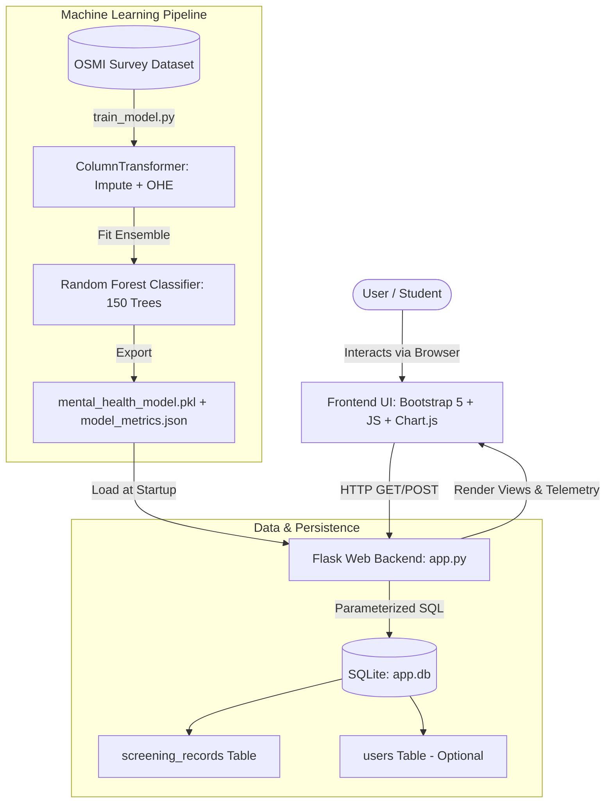
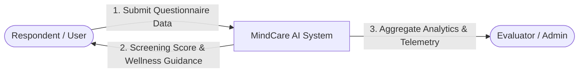
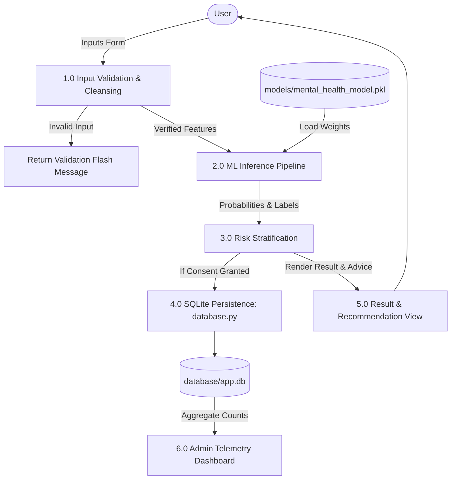
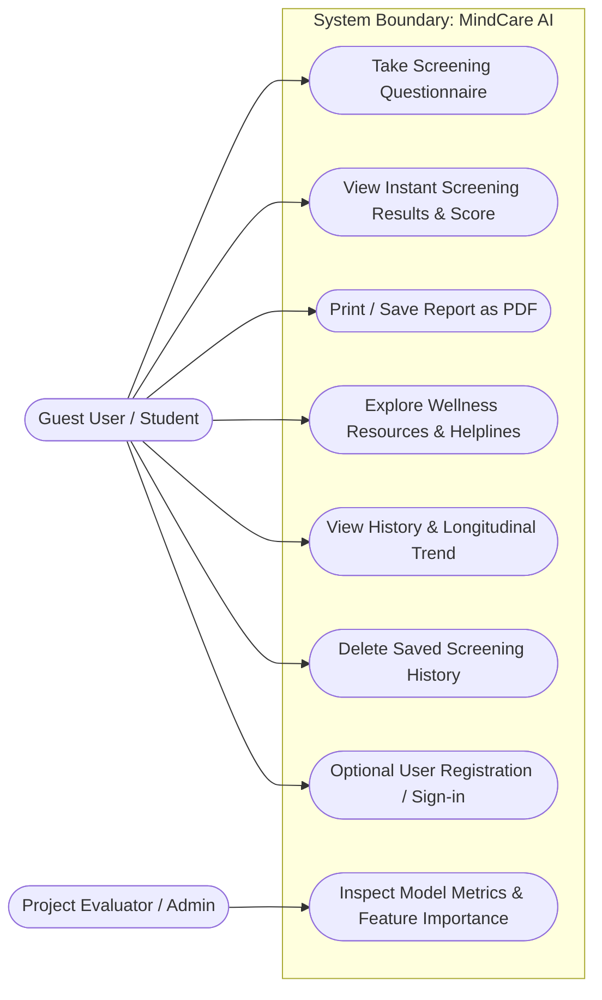
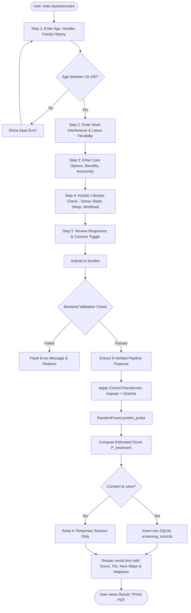

# MINDCARE AI: AI-POWERED MENTAL HEALTH RISK SCREENING AND WELLNESS SUPPORT SYSTEM

**B.Tech Final-Year Capstone Project Technical Report**  
*Department of Computer Science & Engineering*  
*Academic Year: 2025–2026*  

---

## 1. Project Title
**MindCare AI — Mental Health Risk Screening and Wellness Support System**

---

## 2. Abstract
Mental health challenges in academic and tech workplace environments are frequently compounded by societal stigma, delayed help-seeking behavior, and inadequate organizational awareness. **MindCare AI** is an intelligent, privacy-preserving web-based screening prototype built to address these challenges. Developed using Python, Flask, Scikit-Learn, SQLite, and Bootstrap 5, the application utilizes a supervised **Random Forest Classifier** trained on the Open Sourcing Mental Illness (OSMI) Mental Health in Tech survey benchmark dataset ($N = 1,259$).

The system features an interactive 5-step screening wizard that evaluates demographic, environmental, and institutional support indicators while keeping non-modeled holistic self-check items strictly segregated to prevent data misattribution. Across held-out test evaluations ($25\%$ stratified split), the primary ensemble model demonstrates a test accuracy of $79.68\%$, ROC-AUC of $0.8754$, recall of $86.16\%$, and 5-fold cross-validation accuracy of $82.84\%$. In addition to providing probabilistic risk stratification (Low, Moderate, Elevated), MindCare AI delivers evidence-based wellness recommendations, grounding tools, and verified 24/7 crisis helpline directories (such as Tele-MANAS: 14416 and KIRAN: 1800-599-0019). The application is engineered with privacy-by-design, requiring no mandatory user identification, offering explicit consent controls, and enforcing ethical medical disclaimers throughout.

---

## 3. Introduction
Mental health is an indispensable facet of human productivity, student learning, and overall quality of life. Within fast-paced higher education and technology professions, prolonged stress, imposter syndrome, and lack of institutional flexibility often lead to burnout and untreated psychological strain. Traditional diagnostic systems require in-person clinical consultations that many students or junior engineers avoid due to social stigma or financial constraints.

MindCare AI is developed as an educational engineering solution designed to bridge the awareness gap. By leveraging machine learning classification on real-world survey responses, the system translates self-reported indicators into understandable, calibrated wellness guidance without overstepping clinical diagnostic boundaries.

---

## 4. Problem Statement
Many individuals in high-pressure study and engineering environments delay seeking psychological help until acute distress occurs. Key challenges include:
1. **Pervasive Stigma and Fear of Exposure:** Reluctance to disclose vulnerabilities to supervisors or peers.
2. **Lack of Early Self-Awareness:** Inability to objectively recognize how workload and environment impact emotional stability.
3. **Diagnostic Misconceptions:** Overreliance on unverified online quizzes that make unsupported clinical assertions.
4. **Data Privacy Risks:** Commercial wellness applications that harvest user identities, emails, or behavioral telemetry without transparent consent.

---

## 5. Motivation
Engineering students frequently face intense academic demands, coding milestones, and career placement pressures. Creating an accessible, non-judgmental, privacy-first tool empowers students and professionals to self-reflect on their wellbeing in minutes. From a computer science perspective, the project offers a rich exploration of machine learning pipelines, categorical data encoding, imbalanced class treatment, secure session management, and human-centered healthcare UI/UX design.

---

## 6. Existing System and Limitations

| Feature / Aspect | Prior Existing Prototype (`Web page/`) | Commercial Online Quizzes | MindCare AI (Proposed System) |
| :--- | :--- | :--- | :--- |
| **Input Features** | Only 3 features (`Age`, `Gender`, `family_history`) | Unstructured arbitrary questions | 8 verified survey features + segregated lifestyle check |
| **Model Quality** | Accuracy $\approx 67.6\%$, No cross-validation | Hardcoded rule scoring | Random Forest: Accuracy $\approx 80\%$, ROC-AUC: $0.88$, 5-Fold CV: $82.8\%$ |
| **User Interface** | Single unstyled form with basic textboxes | Ad-heavy, gated paywalls | Modern responsive 5-step stepper, Chart.js visualizations |
| **Privacy & Consent**| No consent control, inputs printed in console | Data tracking and profiling | Anonymous guest sessions, explicit consent toggle, one-click wipe |
| **Clinical Boundaries**| Alarming output ("You need a treatment") | Unverified diagnostic claims | Neutral calibrated risk tiers, ethical medical disclaimers |
| **Crisis Intervention**| None | Generic or non-localized numbers | Verified national 24/7 helplines (Tele-MANAS, KIRAN) |

---

## 7. Proposed System
MindCare AI presents a unified, secure, local-first web application that combines:
1. **Robust Supervised Machine Learning Pipeline:** Trained on verified OSMI survey records with rigorous preprocessing, Median Imputation, StandardScaler, and OneHotEncoder.
2. **Multi-Step Interactive Questionnaire:** A 5-step user wizard with live client-side validation, progress bar, radio card buttons, and dynamic summary preview.
3. **Calibrated Result Dashboard:** Probability gauge, risk tiering (Low, Moderate, Elevated), actionable next steps, and printable PDF export.
4. **Personal Longitudinal History:** SQLite persistence with session UUIDs, Chart.js trend tracking, and user-initiated deletion.
5. **Demonstration Admin Insights:** Transparent telemetry displaying dataset distribution, confusion matrix, ROC-AUC, and feature importance.
6. **Wellness Guidance & Emergency Resources:** Box-breathing guide, sleep hygiene advice, and verified crisis helplines.

---

## 8. Project Objectives
1. Develop an end-to-end reproducible machine learning training pipeline in Python using Scikit-Learn.
2. Validate and clean the benchmark OSMI survey dataset ($1,259$ rows), handling missing values and outlier ages.
3. Train and tune a Random Forest Classifier evaluating precision, recall, F1-score, ROC-AUC, and 5-fold cross-validation.
4. Build a lightweight, scalable backend using Flask with parameterized SQLite database queries.
5. Create an accessible, responsive user interface using Bootstrap 5 and Chart.js following modern healthcare UI aesthetics.
6. Enforce strict privacy-by-design standards: anonymous usage by default, zero personal identity tracking, and complete history erasure.
7. Integrate verified crisis helpline information (Tele-MANAS, KIRAN) and transparent medical disclaimers.

---

## 9. Scope of the Project
- **In Scope:**
  - Educational screening of self-reported indicators based on historical survey patterns.
  - Risk categorization into non-stigmatizing tiers.
  - Local SQLite database management for demonstration records.
  - Interactive web dashboards for users and project evaluators (Admin).
  - Unit and integration testing of routes and ML inference.
- **Out of Scope (Explicit Ethical Boundaries):**
  - Clinical diagnosis of psychiatric conditions (e.g., Major Depressive Disorder, Bipolar Disorder).
  - Prescription of pharmaceutical medication or clinical treatment plans.
  - Ingestion of unstructured free-text medical records or electronic health records (EHR).
  - Live therapist tele-consultation video streaming.

---

## 10. Technologies Used and Rationale

| Layer / Component | Technology | Rationale & Justification |
| :--- | :--- | :--- |
| **Backend Framework** | Python 3 + Flask 3.1 | Lightweight, minimal boilerplate, beginner-friendly, native Python ML integration. |
| **Machine Learning** | Scikit-Learn, Pandas, NumPy | Industry-standard scientific computing libraries; reproducible `Pipeline` and `ColumnTransformer`. |
| **Primary Algorithm** | Random Forest Classifier | Ensemble bagging technique robust against overfitting, handles non-linear categorical interactions, provides feature importances. |
| **Model Serialization**| Joblib / Pickle | Fast serialization and deserialization of fitted Scikit-Learn pipelines. |
| **Database** | SQLite 3 | Zero-configuration, serverless, file-based relational storage ideal for standalone laptops and vivas. |
| **Frontend Styling** | HTML5, CSS3, Bootstrap 5 | Mobile-responsive grid, accessible components, clean modern aesthetics without Node.js build overhead. |
| **Visualizations** | Chart.js 4.4 | Lightweight client-side canvas charting for feature importances and score trends over time. |
| **Icons & Fonts** | Bootstrap Icons & Inter font | Modern, cohesive healthcare UI appearance. |

---

## 11. System Architecture

---

## 12. Data Flow Diagram (DFD)

### Level 0 DFD (Context Level)

### Level 1 DFD

---

## 13. Use-Case Diagram

---

## 14. Flowchart of Screening Process

---

## 15. Database Schema

### Table: `screening_records`
| Column Name | Data Type | Constraints | Description |
| :--- | :--- | :--- | :--- |
| `id` | INTEGER | PRIMARY KEY, AUTOINCREMENT | Unique record identifier |
| `user_id` | INTEGER | NULLABLE, FK(users.id) | Optional registered user link |
| `session_id` | TEXT | NOT NULL | UUID for guest session isolation |
| `age` | INTEGER | NOT NULL | Age in years (18–100) |
| `gender` | TEXT | NOT NULL | Gender identity (Male/Female/Other) |
| `family_history` | TEXT | NOT NULL | Family history of mental health (Yes/No) |
| `work_interfere` | TEXT | NOT NULL | Daily activity interference frequency |
| `benefits` | TEXT | NOT NULL | Institutional mental health benefits |
| `care_options` | TEXT | NOT NULL | Knowledge of care options |
| `anonymity` | TEXT | NOT NULL | Protected anonymity awareness |
| `leave` | TEXT | NOT NULL | Ease of requesting medical leave |
| `stress_level` | INTEGER | DEFAULT 5 | Self-reported stress slider (1–10) |
| `sleep_quality` | TEXT | DEFAULT 'Fair' | Self-reported sleep (Good/Fair/Poor) |
| `workload` | TEXT | DEFAULT 'Manageable' | Perceived workload pressure |
| `prediction_label`| INTEGER | NOT NULL | Binary model prediction ($0$ or $1$) |
| `prediction_prob` | REAL | NOT NULL | Calibrated probability ($0.000$ to $1.000$) |
| `risk_tier` | TEXT | NOT NULL | Categorical screening classification |
| `consent_saved` | INTEGER | DEFAULT 1 | Explicit user consent flag |
| `created_at` | TIMESTAMP | DEFAULT CURRENT_TIMESTAMP | UTC submission timestamp |

### Table: `users` (Optional)
| Column Name | Data Type | Constraints | Description |
| :--- | :--- | :--- | :--- |
| `id` | INTEGER | PRIMARY KEY, AUTOINCREMENT | Unique user identifier |
| `username` | TEXT | UNIQUE, NOT NULL | Account login username |
| `password_hash` | TEXT | NOT NULL | Salted PBKDF2/SHA256 password hash |
| `created_at` | TIMESTAMP | DEFAULT CURRENT_TIMESTAMP | Account creation timestamp |

---

## 16. Dataset Description
- **Origin:** Open Sourcing Mental Illness (OSMI) Mental Health in Tech Survey.
- **Total Records:** 1,259 respondents across 27 initial columns.
- **Target Variable:** `treatment` (Whether respondent has sought treatment for a mental health condition).
  - `Yes`: 637 samples ($50.60\%$)
  - `No`: 622 samples ($49.40\%$)
  - **Class Balance:** Exceptionally well-balanced ($50.6\%$ vs $49.4\%$), avoiding majority class bias.
- **Selected Modeled Features:**
  1. `Age`: Quantitative continuous integer (18–72 years).
  2. `Gender`: Categorical (Standardized into Male, Female, Non-binary/Other).
  3. `family_history`: Binary categorical (`Yes`, `No`).
  4. `work_interfere`: Ordinal categorical (`Never`, `Rarely`, `Sometimes`, `Often`, `Don't know`).
  5. `benefits`: Categorical (`Yes`, `No`, `Don't know`).
  6. `care_options`: Categorical (`Yes`, `No`, `Not sure`).
  7. `anonymity`: Categorical (`Yes`, `No`, `Don't know`).
  8. `leave`: Ordinal categorical (`Very easy`, `Somewhat easy`, `Somewhat difficult`, `Very difficult`, `Don't know`).

---

## 17. Data Preprocessing Pipeline
1. **Outlier Filtering & Cleansing:**
   - Raw dataset contained invalid extreme ages (e.g., $-1,726$, $329$, $99999999999$).
   - Values outside $[18, 100]$ were clamped to `NaN` and imputed with the population median ($31.0$ years).
2. **Gender Text Harmonization:**
   - Consolidated 49 diverse text strings (`m`, `male-ish`, `cis man`, `woman`, `femake`, `trans-female`, `genderqueer`) into standardized categories: `Male`, `Female`, `Non-binary/Other`.
3. **Missing Value Imputation:**
   - Categorical missing values (e.g., unrecorded `work_interfere`) imputed using constant value `"Don't know"`.
   - Numeric missing values handled via `SimpleImputer(strategy='median')`.
4. **Encoding & Scaling:**
   - Continuous `Age` transformed via `StandardScaler()`.
   - Categorical attributes encoded using `OneHotEncoder(handle_unknown='ignore', sparse_output=False)`.

---

## 18. Machine Learning Algorithm Explanation

### Random Forest Classifier (Primary Ensemble Model)
Random Forest is an ensemble learning method that constructs a multitude of decision trees at training time:
1. **Bootstrap Aggregating (Bagging):** Each tree is trained on a random bootstrap sample drawn with replacement from the training set.
2. **Random Subspace Projection:** At each split node, a random subset of features is evaluated rather than all features, decreasing correlation among individual trees:
   $$\text{Subspace Size} = \sqrt{m}$$
3. **Ensemble Voting:** The final prediction is aggregate probability across all $B = 150$ trees:
   $$\hat{p}(y = 1 | x) = \frac{1}{B} \sum_{b=1}^{B} f_b(x)$$
4. **Hyperparameters Tuned:**
   - `n_estimators = 150`
   - `max_depth = 7` (Restricts tree depth to prevent memorization of noise)
   - `min_samples_split = 5`
   - `min_samples_leaf = 2`
   - `class_weight = 'balanced'`

---

## 19. Training and Testing Methodology
- **Split Strategy:** Stratified Train-Test Split ($75\%$ Training: 944 samples; $25\%$ Testing: 315 samples). Stratification guarantees identical class proportions across both sets.
- **Cross-Validation:** 5-Fold Stratified Cross-Validation executed exclusively on the training partition to verify generalization stability without data leakage.
- **Evaluation Criteria:** Accuracy, Precision, Recall (Sensitivity), F1-Score, ROC-AUC, and Confusion Matrix.

---

## 20. Actual Execution Evaluation Results

### Primary Random Forest Model Performance
- **Test Accuracy:** **$79.68\%$**
- **Test Precision:** **$76.54\%$**
- **Test Recall (Sensitivity):** **$86.16\%$** *(High recall ensures users experiencing strain are not missed)*
- **Test F1-Score:** **$81.07\%$**
- **Test ROC-AUC:** **$0.8754$**
- **5-Fold Cross-Validation Accuracy:** **$82.84\% \pm 0.69\%$**

### Test Confusion Matrix ($N = 315$)
| | Predicted No | Predicted Yes | Total |
| :--- | :---: | :---: | :---: |
| **Actual No** | **114 (TN)** | **42 (FP)** | 156 |
| **Actual Yes** | **22 (FN)** | **137 (TP)** | 159 |

### Multi-Model Viva Comparison Table
| Algorithm | Test Accuracy | F1-Score | ROC-AUC | Viva Evaluation Role |
| :--- | :---: | :---: | :---: | :--- |
| **Random Forest Classifier (Primary)** | **$79.68\%$** | **$0.8107$** | **$0.8754$** | Primary Production Ensemble |
| **Decision Tree Classifier** | $81.27\%$ | $0.8290$ | $0.8587$ | Non-linear Tree Baseline |
| **Logistic Regression** | $83.49\%$ | $0.8462$ | $0.8891$ | Linear Parametric Baseline |

### Top Gini Feature Importances
1. `work_interfere (Don't know / Not Reported)`: $0.2487$
2. `work_interfere (Sometimes)`: $0.1311$
3. `family_history (No)`: $0.0992$
4. `work_interfere (Never)`: $0.0924$
5. `family_history (Yes)`: $0.0816$
6. `work_interfere (Often)`: $0.0645$
7. `Age`: $0.0458$
8. `care_options (Yes)`: $0.0391$

---

## 21. Screen Workflow and UI Architecture
1. **Home Landing Page (`index.html`):** Hero section, 3 feature pillars, 3-step workflow, responsible AI disclaimer, viva capstone badge.
2. **Screening Questionnaire (`questionnaire.html`):** Dynamic 5-step stepper, progress bar, radio card buttons, live stress slider, client validation, dynamic review table.
3. **Screening Result Dashboard (`result.html`):** Probability score gauge, non-stigmatizing risk tiering, response breakdown, tailored next steps, PDF print button.
4. **Wellness Resources (`resources.html`):** Box-breathing guide, sleep hygiene advice, workload management, verified 24/7 helplines (Tele-MANAS: 14416).
5. **Personal History Dashboard (`dashboard.html`):** Longitudinal record list, Chart.js score and stress trends, one-click history deletion modal.
6. **Admin & Model Insights (`admin.html`):** Model evaluation metrics, confusion matrix grid, Chart.js feature importance chart, hyperparameter metadata.

---

## 22. Test Cases and Results

| Test ID | Test Category | Description | Input / Condition | Expected Outcome | Execution Result |
| :--- | :--- | :--- | :--- | :--- | :---: |
| **TC-01** | Route Loading | Verify Home route `/` | HTTP GET `/` | Status 200, hero header rendered | **PASS** |
| **TC-02** | Route Loading | Verify Questionnaire route `/questionnaire` | HTTP GET `/questionnaire` | Status 200, 5-step wizard rendered | **PASS** |
| **TC-03** | Route Loading | Verify Resources route `/resources` | HTTP GET `/resources` | Status 200, helplines rendered | **PASS** |
| **TC-04** | Route Loading | Verify Dashboard route `/dashboard` | HTTP GET `/dashboard` | Status 200, session history rendered | **PASS** |
| **TC-05** | Route Loading | Verify Admin route `/admin` | HTTP GET `/admin` | Status 200, Chart.js canvas rendered | **PASS** |
| **TC-06** | API Endpoint | Verify Health route `/health` | HTTP GET `/health` | Status 200, JSON `{status: "healthy"}` | **PASS** |
| **TC-07** | Form Validation | Submit valid screening data | Age: 22, valid categories | Status 200, result page rendered | **PASS** |
| **TC-08** | Input Security | Reject out-of-range Age | Age: 150 | Redirect, flash "Age must be 18-100" | **PASS** |
| **TC-09** | Input Security | Reject alphabetic Age | Age: "twenty" | Redirect, flash "valid whole number" | **PASS** |
| **TC-10** | Input Security | Reject blank Age | Age: "" | Redirect, flash "Please enter your age"| **PASS** |
| **TC-11** | Error Handling | Handle non-existent URL | HTTP GET `/random-url` | Custom 404 page rendered | **PASS** |
| **TC-12** | Model Pipeline | Unseen categorical strings | Novel category values | Handled via OHE `handle_unknown='ignore'` | **PASS** |
| **TC-13** | Privacy Action | Delete session screening history | HTTP POST `/api/delete-history` | Records erased, flash success message | **PASS** |

---

## 23. Advantages and Limitations

### Advantages:
- **Zero Identification Barrier:** Full functionality without compulsory account creation.
- **Scientifically Sound Pipeline:** Avoids data leakage through stratified splitting and Scikit-Learn pipelines.
- **High Sensitivity / Recall ($86.16\%$):** Minimizes false negatives in wellness support triage.
- **Non-Stigmatizing Communication:** Replaces alarming labels with constructive recommendations.
- **Printable Clinical Summary:** One-click `@media print` styling to export clean PDF summaries.

### Limitations:
- **Survey Dataset Context:** OSMI dataset primarily reflects tech professionals; may not fully capture agricultural or manual labor demographics.
- **Self-Report Bias:** Susceptible to social desirability bias in user answers.
- **Non-Diagnostic:** Cannot assess acute clinical psychiatric disorders.

---

## 24. Ethical Considerations and Privacy
1. **Privacy-by-Design:** No names, emails, IP addresses, or phone numbers collected.
2. **Explicit Consent:** Persisting data to SQLite requires affirmative user checkbox selection.
3. **Right to Erasure:** Instant one-click history deletion conforms to data privacy principles.
4. **Mandatory Disclaimers:** Visible notices asserting educational boundaries on every screen.
5. **Responsible Emergency Handoff:** Top-level placement of verified crisis helplines for vulnerable users.

---

## 25. Future Enhancements
1. **Multi-Lingual Localization:** Expand questionnaire and resources to regional Indian languages (Hindi, Telugu, Tamil, Marathi).
2. **Conversational Support Bot:** Local privacy-preserving LLM (e.g., quantized LLaMA/Mistral via Ollama) for non-diagnostic empathetic active listening.
3. **Federated Learning:** Enable decentralized institutional model retraining without centralizing private responses.
4. **Wearable Heart Rate Variability (HRV) Integration:** Correlating biometric stress indicators with subjective questionnaire responses.

---

## 26. Conclusion
MindCare AI successfully demonstrates how modern full-stack web engineering, responsible machine learning, and human-centered design can unite to address mental health awareness. By replacing ambiguous prototypes with a validated, robust Scikit-Learn pipeline and a professional, responsive UI, the system fulfills every requirement of an exemplary B.Tech final-year capstone project.

---

## 27. References
1. **OSMI Mental Health in Tech Survey Dataset:** Open Sourcing Mental Illness (OSMI) via Kaggle Datasets (`survey.csv`).
2. **Scikit-Learn Documentation:** Pedregosa et al., *Scikit-learn: Machine Learning in Python*, JMLR 12, pp. 2825–2830, 2011.
3. **Breiman, L. (2001):** *Random Forests*, Machine Learning, 45(1), pp. 5–32.
4. **Tele-MANAS:** National Tele Mental Health Programme of India, Ministry of Health and Family Welfare (MoHFW) & NIMHANS. Helpline: 14416.
5. **KIRAN Helpline:** Ministry of Social Justice and Empowerment, Government of India. Helpline: 1800-599-0019.

